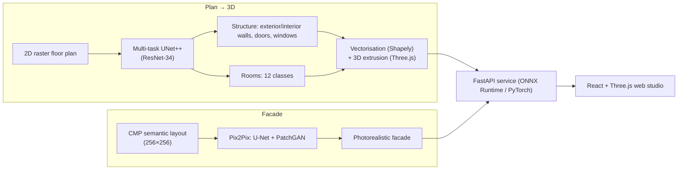

# 🏛️ ArchiGen 3D — From 2D floor plan to 3D building, and from layout to facade

[](https://github.com/KhawlaHawari/archigen-studio/actions/workflows/mlops-ci.yml)
[](https://www.python.org/)
[](https://pytorch.org/)
[](https://onnxruntime.ai/)
[](https://fastapi.tiangolo.com/)
[](https://vitejs.dev/)
[](https://threejs.org/)
[](https://dvc.org/)
[](https://mlflow.org/)

> **ArchiGen** turns a **2D house floor plan into a 3D model** (multi-task UNet++ semantic segmentation, CubiCasa5K)
> and a **colour-coded facade layout into a photorealistic elevation** (Pix2Pix conditional GAN, CMP Facades),
> inside a cinematic web studio (React + Three.js) backed by a FastAPI service.

---


## 🧭 Overview



---

## 📊 Results

> Metrics are **never typed in by hand**: the training and evaluation scripts write them to `models/metrics/*.json`,
> the API serves them (`GET /metrics/summary`) and the UI displays them.
> The tables below contain measured values only.

**Status:** Run 2 (recipe v2, ~8 h on Kaggle) is the current reference. Run 1 is kept below for comparison.

### Run 2: Kaggle, GPU T4 ×2, recipe v2 (current results)

Notebook: [`kaggle/archigen_kaggle_run2.ipynb`](kaggle/archigen_kaggle_run2.ipynb). Neither job hit its time budget
(`stopped_by_time_budget: false`).

#### Facades (CMP test split, 106 images, 256×256, per-image means)

| Model | Epochs run | Best epoch | L1 ↓ | PSNR ↑ | SSIM ↑ | LPIPS (Alex) ↓ | LPIPS (Squeeze) ↓ | KID ×10³ ↓ |
| :--- | ---: | ---: | ---: | ---: | ---: | ---: | ---: | ---: |
| U-Net, L1 only (baseline) | 72 | 52 | **0.323** | **13.91 dB** | **0.344** | 0.587 | 0.509 | 129.10 ± 9.20 |
| Pix2Pix (U-Net + PatchGAN, recipe v2) | 100 | 81 | 0.363 | 12.49 dB | 0.271 | **0.414** | **0.316** | **66.03 ± 7.80** |

Recipe v2 for Pix2Pix: L1 weight 30, LPIPS (SqueezeNet) perceptual loss ×10, feature-matching loss ×10, EMA generator
(decay 0.999), constant → linear LR decay from epoch 50, crop jitter, and checkpoint selection on **validation LPIPS**
(no L1-based early stopping). Batch size 2, seed 42.

- **Perceptual quality:** Pix2Pix is clearly better than the baseline. KID is **49 % lower** (66.0 vs 129.1) and
  LPIPS (AlexNet) is 29 % lower (0.414 vs 0.587). Compared with Run 1, Pix2Pix LPIPS (AlexNet) went from 0.660 to 0.414.
- **Pixel metrics:** the L1 baseline still wins on L1, PSNR and SSIM. This is expected: L1 training gives blurry
  "average" images that score well pixel-wise but look less realistic.
- **Against the historical reference** (EMA model, same test split: L1 0.340, PSNR 12.97 dB, SSIM 0.289,
  LPIPS-Squeeze 0.310, KID 63.55): Run 2 is close (LPIPS-Squeeze +0.006, KID +2.5) but does not beat it.

#### Floor plans (CubiCasa5K test split, 400 plans, 512×512, mixed precision, 25 epochs, best epoch 24)

Recipe v2: UNet++ with an **ImageNet ResNet-34 encoder**, cosine LR, class weights for rare rooms, batch 4 × 2
(gradient accumulation), selection on validation room mIoU.

| Evaluation | Wall IoU ↑ | Door IoU ↑ | Window IoU ↑ | Structure mIoU ↑ | Room mIoU (11 rooms) ↑ | Room pixel accuracy ↑ | Structure pixel accuracy ↑ |
| :--- | ---: | ---: | ---: | ---: | ---: | ---: | ---: |
| Single pass | 0.733 | 0.668 | 0.772 | 0.777 | 0.640 | 0.940 | 0.978 |
| 4-fold TTA (flips) | **0.743** | **0.680** | **0.784** | **0.786** | **0.669** | **0.945** | **0.979** |
| *Run 1 (for comparison)* | *0.653* | *0.551* | *0.692* | *0.704* | – | *0.907* | *0.969* |
| *Historical reference, TTA* | *0.749* | *0.632* | *0.747* | – | *0.582\** | *0.881* | – |

\* The reference room mIoU uses 10 CubiCasa classes; ArchiGen uses 11 room classes (background excluded). The class
sets differ, so treat that comparison as indicative only. Wall, door and window IoU use the same definitions.

| IoU per class (TTA) | |
| :--- | :--- |
| **Structure** | background 0.981 · exterior wall 0.791 · window 0.784 · interior wall 0.696 · door 0.680 |
| **Rooms** | bedroom 0.884 · bathroom 0.840 · living room 0.793 · hallway 0.780 · kitchen 0.770 · balcony 0.770 · storage 0.659 · closet 0.612 · technical 0.560 · dining 0.538 · office 0.153 |

Run 2 beats the reference on doors, windows and room accuracy and is level on walls (−0.6 pt). The three rare rooms
that scored 0.000 in Run 1 are now predicted (dining 0.54, technical 0.56, office 0.15). Office (0.04 % of room
pixels) is still the weakest class.

Sources: `models/metrics/facade_pix2pix_best_test.json`, `facade_unet_l1_best_test.json`,
`floorplan_unetpp_best_test.json`, `floorplan_unetpp_best_test_tta.json` and the matching `*_val.json`.

### Run 1: Kaggle, GPU T4 ×2 (reduced budget, both datasets in one run)

#### Facades (CMP test split, 106 images, 256×256, per-image means)

| Model | Epochs run | Best epoch | L1 ↓ | PSNR ↑ | SSIM ↑ | LPIPS ↓ |
| :--- | ---: | ---: | ---: | ---: | ---: | ---: |
| U-Net, L1 only (baseline) | 18 | 8 | **0.334** | **13.76 dB** | **0.332** | **0.613** |
| Pix2Pix (U-Net + PatchGAN) | 11 | 1 | 0.360 | 13.09 dB | 0.299 | 0.660 |

Validation L1 (selection metric): baseline 0.3273, Pix2Pix 0.3506. Pix2Pix is **7.1 % worse** than the baseline,
so the target (≥ 5 % improvement) is **not met**. The baseline is better on all four test metrics.

> ⚠️ **Why both runs are short.** Neither model hit its time budget (`stopped_by_time_budget: false`): both were stopped
> by **early stopping** (10 epochs without a better validation L1). Pix2Pix had its best validation L1 at **epoch 1**:
> the adversarial loss trades pixel accuracy for sharper, more realistic textures, so selecting and stopping on L1 ends
> its training almost immediately. This comparison is therefore not conclusive. The next run will train Pix2Pix without
> L1-based early stopping.

#### Floor plans (CubiCasa5K test split, 400 plans, 256×256, mixed precision, 9 epochs, stopped by the 50-min time budget)

| Structure mIoU ↑ | Wall IoU ↑ | Room mIoU ↑ | Room pixel accuracy ↑ | Structure pixel accuracy ↑ |
| ---: | ---: | ---: | ---: | ---: |
| 0.704 | 0.653 | 0.465 | 0.907 | 0.969 |

| IoU per class | |
| :--- | :--- |
| **Structure** | background 0.972 · exterior wall 0.718 · window 0.692 · interior wall 0.587 · door 0.551 |
| **Rooms** | bedroom 0.729 · living room 0.722 · hallway 0.643 · bathroom 0.641 · kitchen 0.627 · balcony 0.611 · storage 0.374 · closet 0.290 · **dining 0.000 · office 0.000 · technical 0.000** |

The three rooms at 0.000 are rare classes (≈ 0.5 %, 0.1 % and 0.4 % of room pixels): with 9 epochs the model never predicts them.

Run 1 values were measured with the same scripts; their JSON files were replaced by the Run 2 outputs.
All metric files are written by `src.evaluation.evaluate` and the training scripts.
Trained weights will be published at: **`<link to be added>`** (GitHub Release or DVC remote); they are not stored in Git.

### Evaluation protocol (facades)
- Official splits **400 / 100 / 106**, **256×256** resolution, identical data for the baseline and Pix2Pix.
- Checkpoint selection on **validation only** (L1 for the baseline and Run 1; validation LPIPS for Pix2Pix in Run 2);
  the test split is evaluated once, after the protocol is frozen.
- Test metrics **averaged per image**: L1, PSNR, SSIM, LPIPS (AlexNet and SqueezeNet); KID ×10³ over 100 subsets of 50.
- Target: Pix2Pix validation L1 **at least 5 % better** than the U-Net baseline — a miss is reported as is.

### Evaluation protocol (floor plans)
- **Official** CubiCasa5K splits **4,200 / 400 / 400**.
- Per-class IoU (structure and rooms), mIoU, pixel accuracy; room pixels of unknown type (label 255) are excluded.

### Data audit (measured 13 Nov 2026 — `python -m src.data.audit_data`)
| Dataset | Findings |
| :--- | :--- |
| **CMP Facades** | 606 pairs (66.01 / 16.50 / 17.49 %), 0 corrupted files, 0 duplicates (files, photos, label maps) |
| **CubiCasa5K** | 5,000 plans, 0 missing files, 0 rasterisation failures; **18 groups of identical images, 5 of them across train and val** (minor leakage, documented) |
| **CubiCasa rooms** | ≈ 8.5 % of room pixels are `Undefined` in the original annotations → ignored by the loss and the metrics |

---

## 🗂️ Data

Datasets are **not** stored in Git (see `.gitignore`); they are tracked with DVC or downloaded.

| Dataset | Expected location | Source / licence |
| :--- | :--- | :--- |
| CMP Facades (pix2pix archive) | `data/raw/facades/{train,val,test}/*.jpg` (`dvc pull data/raw/facades.dvc`) | [CMP Facade DB](https://cmp.felk.cvut.cz/~tylecr1/facade/) — CC BY-SA |
| CubiCasa5K | `data/raw/cubicasa5k/` (folder containing `train.txt`, `val.txt`, `test.txt`) | [CubiCasa5K](https://github.com/CubiCasa/CubiCasa5k) — CC BY-NC 4.0 |

Preparation:
```bash
python -m src.data.rasterize_cubicasa   # SVG -> 512×512 NPZ, official splits -> data/processed/cubicasa_cache/{train,val,test}
python -m src.data.audit_data           # integrity, SHA-256 duplicates, class frequencies -> data/processed/data_audit_summary.json
```

---

## 🏋️ Training & evaluation

```bash
# Facades (core)
python -m src.training.train_facade --mode l1_baseline     # U-Net baseline, L1 only
python -m src.training.train_facade --mode pix2pix         # U-Net + PatchGAN (LSGAN + L1 + feature matching)

# Floor plans (extension) — GPU recommended
python -m src.training.train_floorplan                     # 512×512
python -m src.training.train_floorplan --image-size 256 --amp --time-budget-min 50   # reduced, documented budget

# Final test evaluation (refuses any checkpoint not trained on real data)
python -m src.evaluation.evaluate facade    --checkpoint models/checkpoints/facade_pix2pix_best.pt
python -m src.evaluation.evaluate facade    --checkpoint models/checkpoints/facade_unet_l1_best.pt
python -m src.evaluation.evaluate floorplan --checkpoint models/checkpoints/floorplan_unetpp_best.pt
```

- Hyperparameters: `params.yaml` (`training_facade`, `training_floorplan`).
- Every checkpoint records its data source (`data_source`), hyperparameters and seed;
  ONNX export and evaluation **refuse** untrained weights or weights trained on synthetic data.
- MLflow tracking (`mlflow.db`); per-epoch sample grids in `models/samples/`.

### Training on Kaggle (free GPU)
Measured on CPU (12 threads): facades ≈ 8 h (L1) and ≈ 12 h (Pix2Pix) for 50 epochs; UNet++ at 512² ≈ 35 h **per epoch**.
A ready-made notebook trains everything in ≈ 1 h on **GPU T4 ×2**:

1. `python kaggle/make_bundle.py --part facades` → `dist/archigen_facades.zip` (≈ 31 MB, code + facades); upload it as a Kaggle *Dataset*.
2. Import `kaggle/archigen_kaggle.ipynb` and add the dataset (for floor plans, also add the public *CubiCasa5k* dataset — it is rasterised automatically in the notebook).
3. *Accelerator*: **GPU T4 ×2**, *Internet*: **On**, then **Save Version → Save & Run All**.
4. Download `archigen_results.zip` (checkpoints, val/test metrics, sample grids, logs) from the *Output* tab.

---

## 🖥️ Running the app

**Backend (API)** — from the repository root:
```bash
pip install -r requirements.txt
uvicorn src.api.main:app --port 8000
```
Interactive docs: http://localhost:8000/docs

**Frontend (web studio)** — Node.js ≥ 18:
```bash
cd frontend
npm install
npm run dev        # http://localhost:5173  (the Vite proxy forwards /predict, /health, /metrics… to port 8000)
```

| Page | What it shows |
| :--- | :--- |
| **Home** | Cinematic landing page with video, presenting *Plan → 3D* and the *Facade generator* |
| **Floorplan workspace** | Plan upload, 2D / 3D / split views, detected rooms, furnishing |
| **Generative studio** | *Furniture* (image → 3D) and *Facades* tabs |

Containerised deployment: `docker compose up --build -d`.

---

## 🔄 DVC pipeline

`dvc repro` runs, on real data only:

| Stage | Command | Output |
| :--- | :--- | :--- |
| `rasterize_cubicasa` | `python -m src.data.rasterize_cubicasa` | `data/processed/cubicasa_cache` |
| `audit_data` | `python -m src.data.audit_data` | `data/processed/data_audit_summary.json` |
| `train_facade_baseline` | `train_facade --mode l1_baseline` | `models/checkpoints/facade_unet_l1_best.pt` |
| `train_facade` | `train_facade --mode pix2pix` | `models/checkpoints/facade_pix2pix_best.pt` |
| `train_floorplan` | `train_floorplan` | `models/checkpoints/floorplan_unetpp_best.pt` |
| `evaluate_test` | `src.evaluation.evaluate` (×3) | `models/metrics/*_best_test.json` |
| `export_onnx_models` | `src.mlops.export_onnx` | `models/onnx/*.onnx` |
| `verify_onnx_parity` | `src.mlops.onnx_verifier` | `models/onnx/parity_report.json` |
| `benchmark_inference_latency` | `src.mlops.benchmark_latency` | `models/onnx/latency_benchmark.json` |
| `mlflow_tracking_and_registry` | `src.mlops.model_registry` | `models/mlflow_registry_summary.json` |
| `drift_baseline_and_monitor` | `src.mlops.drift_detector --mode baseline` | `data/monitoring/reference_profile.json` |

DVC remote: MinIO (`docker compose up minio minio-init -d`), S3 or a local folder — see `dvc_remote_setup.sh` / `dvc_remote_setup.ps1`.

---

## 📈 MLOps

- **GitHub Actions CI** (`.github/workflows/mlops-ci.yml`): unit and API tests, ONNX export, parity, latency, Docker build, Locust load test.
  CI has neither the datasets nor the weights: it validates the **technical pipeline** on weights explicitly labelled *untrained* (`ARCHIGEN_CI_UNTRAINED=1`).
- **Drift monitoring** (`src/mlops/drift_detector.py`): PSI, Kolmogorov-Smirnov, Wasserstein and Jensen-Shannon on inputs and outputs;
  the reference profile is built from the real *train* splits. Endpoints under `/monitoring/drift/*`, dashboard at `/monitoring/drift/dashboard`.
- **Continuous training** (`src/mlops/continuous_retraining.py`), triggered by a drift threshold.
- **MLflow model registry** with Staging → Production promotion (`src/mlops/model_registry.py`).

---

## 📁 Project structure

```
archigen-3d/
├── src/
│   ├── config.py                 # paths, classes, colours
│   ├── data/                     # facade_dataset, rasterize_cubicasa, audit_data, svg_preprocessor
│   ├── models/                   # unet_plus_plus (multi-task UNet++), pix2pix_cgan
│   ├── training/                 # trainer_base, train_facade, train_floorplan, checkpoints
│   ├── evaluation/               # metrics (L1, PSNR, SSIM, LPIPS, IoU), evaluate (final test)
│   ├── geometry/                 # vectorisation and 3D extrusion
│   ├── mlops/                    # export_onnx, onnx_verifier, benchmark_latency, mlflow_tracker,
│   │                             # model_registry, drift_detector, continuous_retraining, dvc_remote
│   └── api/                      # FastAPI: main, service, monitoring_endpoints, static/
├── frontend/                     # React + Vite + Three.js
│   ├── src/                      # App and components (Viewer3D, Floorplan2DCanvas, GenerativeStudio…)
│   └── public/landing/           # home page (video in public/showcase/media/)
├── kaggle/                       # make_bundle.py + archigen_kaggle.ipynb
├── tests/                        # models, ONNX parity, API, drift, real-data pipeline
├── data/                         # raw/ (DVC), processed/ (generated), monitoring/
├── models/                       # checkpoints/, onnx/, metrics/ (generated)
├── dvc.yaml · params.yaml · requirements.txt · Dockerfile · docker-compose.yml
```

Tests: `pytest tests/ -v`

---

## ⚠️ Known limitations

- **Preliminary models**: Run 1 used a reduced budget; Pix2Pix does not yet beat the L1 baseline. Without checkpoints
  in `models/`, the API starts but its predictions are not meaningful.
- The frontend calls `/design`, `/facade/generate` and `/furniture/*`, which are **not implemented** in this version of the backend:
  generating facades and furniture from the studio currently returns an error.
- The CMP label maps in the pix2pix archive are JPEG-compressed, so exact per-class pixel counts for facades are not possible.
- The 5 train/val duplicate groups in CubiCasa5K are kept to respect the official splits; they are documented by the audit.
- The floor-plan model is trained with a **reduced budget**: 256×256 input, mixed precision, about 50 minutes on a Kaggle T4
  (`--image-size 256 --amp --time-budget-min 50`), and evaluated at that resolution. Its scores are a lower bound compared
  with the full 512×512 protocol.
- The inference-latency SLA (p95 < 2 s on CPU) is measured in CI by `src.mlops.benchmark_latency`, but a miss does **not**
  fail the pipeline: GitHub's shared runners are slow and the figure is informative only there. Misses appear as warning
  annotations in the run summary. Set `ARCHIGEN_LATENCY_STRICT=1` (or pass `--strict`) to make them fail the build.

---

## 📚 References

- P. Isola et al., *Image-to-Image Translation with Conditional Adversarial Networks* (Pix2Pix), CVPR 2017.
- R. Tyleček, R. Šára, *Spatial Pattern Templates for Recognition of Objects with Regular Structure*, GCPR 2013 — CMP Facade Database.
- A. Kalervo et al., *CubiCasa5K: A Dataset and an Improved Multi-Task Model for Floorplan Image Analysis*, SCIA 2019.
- Z. Zhou et al., *UNet++: A Nested U-Net Architecture for Medical Image Segmentation*, DLMIA 2018.
- R. Zhang et al., *The Unreasonable Effectiveness of Deep Features as a Perceptual Metric* (LPIPS), CVPR 2018.
